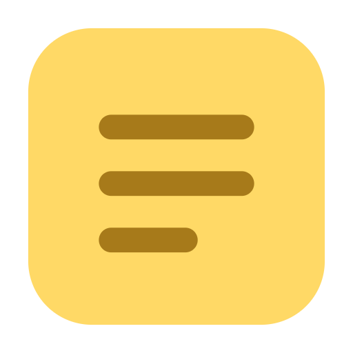
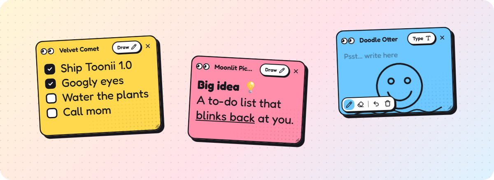

<div align="center">



# Toonii

**Cartoon sticky notes with googly eyes that float on your desktop.**
Type, draw, tick things off. The eyes follow your mouse around.


[**Download**](../../releases/latest) · [Features](#features) · [Shortcuts](#keyboard-shortcuts) · [Build from source](#build-from-source)



</div>

## Features

- **Notes that live on your desktop.** Each note is its own small window. Drag it by the
  title bar, resize it from the corner, pin it to stay on top of everything else.
- **Googly eyes.** Every note watches your cursor, blinks, and looks surprised when you
  grab it. Ticking a checklist item throws confetti; closing a note goes *poof*.
- **Type or draw.** Switch any note to Draw mode for a pen and eraser, with undo.
- **Rich text that stays tidy.** Bold, italic, underline, strike, bullets, checklists,
  five fonts, text colors and sizes. The toolbar appears only when you click into the
  text or select some, and sits outside the note so it never covers what you wrote.
- **Text fits itself.** Short notes get big text and long ones shrink to fit, until
  you pick a size yourself.
- **Make it yours.** Six colors, fonts, line spacing, and a playful tilt of up to ±15°.
  Hover an option to preview it live. 🎲 picks a random look.
- **Names with personality.** New notes are called things like *Velvet Comet* or
  *Moonlit Pickle* instead of "Note 7". Click the title to rename.
- **Nothing gets lost.** Notes save as you type. Closed notes with content can be
  brought back from the tray menu → **Recently closed**.
- **Private by design.** No account, no cloud, no network calls. Notes are a single
  JSON file on your computer.
- **Tiny.** A 1.3 MB installer and a 3.6 MB app, built with [Tauri](https://tauri.app) on
  the Edge WebView2 engine that ships with Windows.

## Download

Get the latest Windows build from [**Releases**](../../releases/latest):

| File | What it is |
|---|---|
| `Toonii-Setup-1.0.0.exe` (1.3 MB) | Installer. Per-user, no admin rights needed, adds a Start menu shortcut. |
| `Toonii-1.0.0-portable.exe` (3.6 MB) | Single file. Runs from anywhere without installing. |

Toonii uses Microsoft Edge WebView2, which is built into Windows 10 and 11. On the rare PC
without it, the installer fetches it automatically.

> [!NOTE]
> The builds are not code-signed yet, so Windows SmartScreen may warn on first launch.
> Click **More info → Run anyway**.

macOS builds come from the same code (`npm run build` on a Mac).

## Using Toonii

| To… | Do this |
|---|---|
| Make a note | <kbd>Ctrl</kbd>+<kbd>Alt</kbd>+<kbd>N</kbd> from anywhere, or tray icon → **New note** |
| Format text | Click into the text or select some: the toolbar pops up under the note |
| Start a checklist | Type `[] ` at the start of a line (`- ` for bullets). Click a box to tick it |
| Draw | Click **Draw** in the title bar (<kbd>Ctrl</kbd>+<kbd>D</kbd>) |
| Rotate | Hold the mouse button on a note and scroll, or <kbd>Alt</kbd> + scroll |
| Keep on top | Pin button in the title bar. A filled pin means pinned |
| Change color, font, size | Palette button in the title bar, or right-click the note |
| Hide everything | <kbd>Ctrl</kbd>+<kbd>Alt</kbd>+<kbd>H</kbd> (again to bring them back) |
| Restore a closed note | Tray icon → **Recently closed** |
| Start with Windows | Tray icon → **Open at login** |

## Keyboard shortcuts

| Action | Windows | macOS |
|---|---|---|
| New note (anywhere) | <kbd>Ctrl</kbd>+<kbd>Alt</kbd>+<kbd>N</kbd> | <kbd>⌘</kbd><kbd>⌥</kbd><kbd>N</kbd> |
| Show / hide all notes (anywhere) | <kbd>Ctrl</kbd>+<kbd>Alt</kbd>+<kbd>H</kbd> | <kbd>⌘</kbd><kbd>⌥</kbd><kbd>H</kbd> |
| New note (from a note) | <kbd>Ctrl</kbd>+<kbd>N</kbd> | <kbd>⌘</kbd><kbd>N</kbd> |
| Customize panel | <kbd>Ctrl</kbd>+<kbd>E</kbd> | <kbd>⌘</kbd><kbd>E</kbd> |
| Draw / Type | <kbd>Ctrl</kbd>+<kbd>D</kbd> | <kbd>⌘</kbd><kbd>D</kbd> |
| Pen / Eraser (Draw mode) | <kbd>P</kbd> / <kbd>E</kbd> | <kbd>P</kbd> / <kbd>E</kbd> |
| Undo stroke (Draw mode) | <kbd>Ctrl</kbd>+<kbd>Z</kbd> | <kbd>⌘</kbd><kbd>Z</kbd> |
| Bold / Italic / Underline | <kbd>Ctrl</kbd>+<kbd>B</kbd> / <kbd>I</kbd> / <kbd>U</kbd> | <kbd>⌘</kbd><kbd>B</kbd> / <kbd>I</kbd> / <kbd>U</kbd> |
| Close note | <kbd>Ctrl</kbd>+<kbd>W</kbd> | <kbd>⌘</kbd><kbd>W</kbd> |

## Where your notes live

Everything is in one file, `notes.json`:

- Windows: `%APPDATA%\Toonii\notes.json`
- macOS: `~/Library/Application Support/Toonii/notes.json`

Writes are atomic (temp file + rename), so a crash can't leave half a file. Back it up or
copy it to another machine to move your notes. Notes from the app's old name
(Stickynotee) are copied over on first launch.

## Build from source

Needs [Node.js](https://nodejs.org) 20+, [Rust](https://rustup.rs) (stable) and, on Windows,
the Visual Studio C++ Build Tools. See [Tauri prerequisites](https://tauri.app/start/prerequisites/).

```sh
git clone <this repo>
cd toonii
npm install
npm start            # run the app (debug build)
```

Package it:

```sh
npm run build        # src-tauri/target/release/toonii.exe + bundle/nsis/*-setup.exe
npm run icons        # regenerate the app and tray icons in assets/
```

Set `TOONII_DATA_DIR` to run against a throwaway notes folder while testing.

**Releases:** pushing a tag like `v1.0.0` runs [`release.yml`](.github/workflows/release.yml),
which builds on Windows and attaches both `.exe` files to a GitHub release.

## Project layout

```
src-tauri/
  src/main.rs          windows, stage, tray, global shortcuts, right-click menu, commands
  src/store.rs         notes.json persistence (debounced, atomic writes)
  tauri.conf.json      app, bundle and security config
src/renderer/
  bridge.js            the pages' small API onto the Rust commands and events
  note.html|css|js     the note: editor, auto-fit text, drawing canvas, customize panel
  menu.html|css|js     the Toon-styled right-click menu
  cursors/             cartoon cursors
  fonts/               Fredoka (SIL OFL)
scripts/make-icons.js  draws the icons as PNG/ICO with no dependencies
docs/UX-RESEARCH.md    research and design decisions
```

Pages load only bundled files under a strict Content Security Policy, and paste lands as
plain text, so nothing remote ever loads inside a note.

## License

[MIT](LICENSE) © 2026 Sudhara Lakshan. The Fredoka font is under the
[SIL Open Font License](src/renderer/fonts/fredoka-LICENSE.txt).
